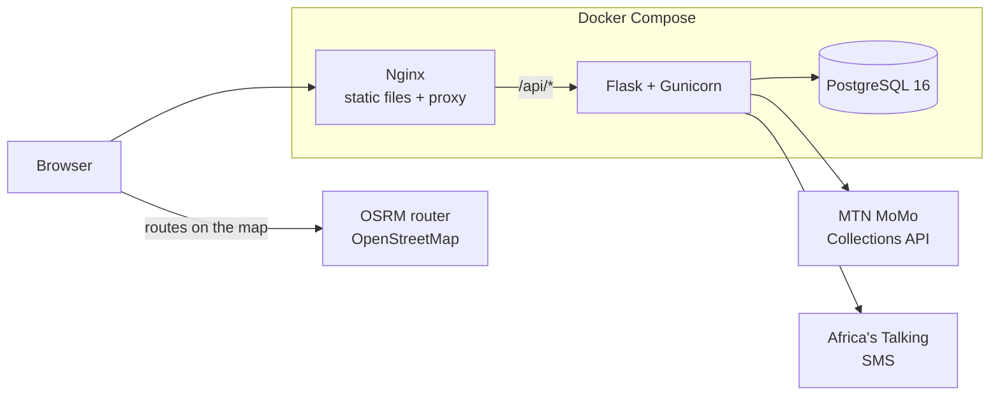
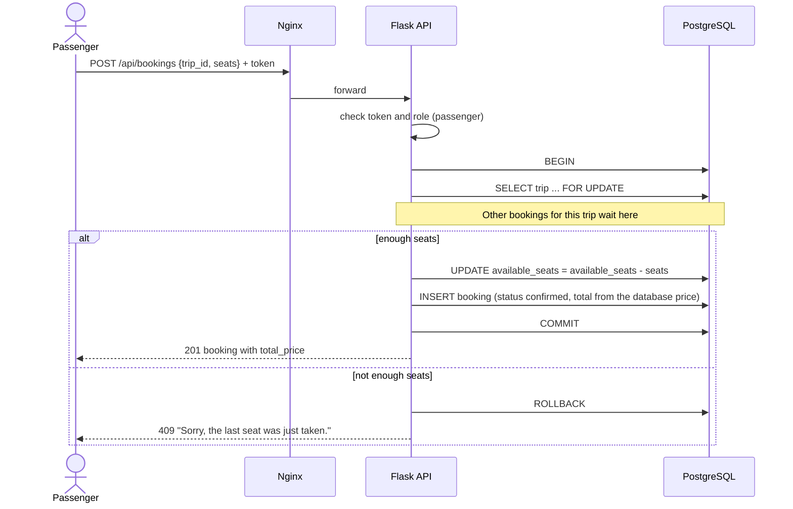
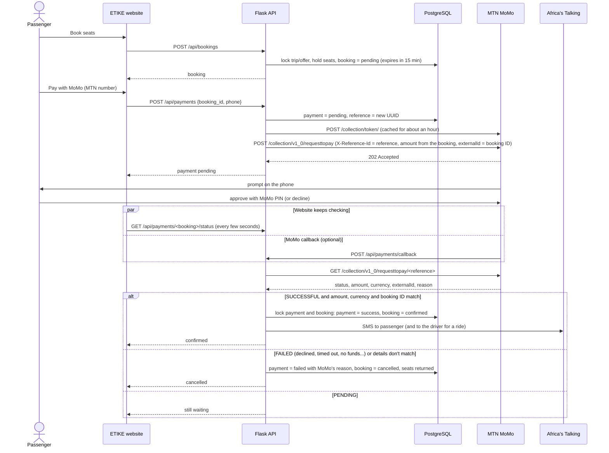

# Architecture

ETIKE is a three-tier client–server application. Everything runs in Docker containers started by Docker Compose.

| Tier | Technology | Job |
|------|------------|-----|
| Frontend | Plain HTML, CSS and JavaScript | What passengers, drivers and staff see in the browser |
| Backend | Python 3.12, Flask REST API, Gunicorn | Business rules and data access, exposed under `/api` |
| Database | PostgreSQL 16 | Stores all data |

Nginx sits in front. It serves the frontend files directly and forwards every `/api/*` request to Flask. The browser only ever talks to Nginx, so there is no cross-origin traffic.

MoMo and Africa's Talking are optional: without their keys, payments answer 503 and SMS is skipped.

## Scope

The platform currently covers **private and shared rides** between districts: drivers post rides, passengers book them, the driver starts and ends the ride in the app, and passengers then pay with MTN MoMo. **Bus booking is a future phase**: bus companies would need a full operator system (fleets, schedules, ticket scanning), which is a separate product. Its modules below are marked *future phase*. They stay in the code and are tested, but are switched off with `FEATURE_BUS_BOOKING` (default off, `app/features.py`):

- bus endpoints (`/api/trips...`) and admin company endpoints answer 404 "Bus booking is not available yet";
- `POST /api/bookings` answers 400 for a bus booking;
- `GET /api/config` tells the website, which hides every element marked `data-feature="bus"`;
- the data scripts skip bus companies and trips.

No tables or data are removed; the booking service stays generic and still supports bus trips internally.

## Backend modules

| Module | Where | What it does |
|--------|-------|--------------|
| Models | `app/models/` | `users`, `drivers`, `driver_documents`, `messages`, `ride_locations`, `vehicles`, `vehicle_photos`, `bus_companies`, `routes`, `bus_trips`, `ride_offers`, `bookings`, `booking_seats`, `payments`, `ratings`, `login_codes`, with CHECK constraints for allowed values, seat counts and scores |
| Auth | `app/auth/` | Sign up (passenger or driver) and log in with phone number and password; `/me`. One-click test-account login only when `DEMO_LOGIN` is on (never in production). SMS-code login exists in the API but is not on the website. JWT tokens valid 12 hours (Flask-JWT-Extended), Werkzeug password hashes, login codes stored as keyed hashes, and the `role_required` decorator |
| Search | `app/routes/search.py` | Places, routes, ride offers, and (future phase) bus trips. Public. Also `GET /api/config` |
| Drivers | `app/routes/drivers.py`, `app/driver_documents.py` | Legal documents (upload, replace, download your own), vehicles, and posting rides (approved drivers only) |
| Bookings | `app/routes/bookings.py`, `app/services/booking_service.py` | Book (pending, seats held), confirm, cancel and release expired holds, without double booking |
| Payments *(future phase, behind FEATURE_BUS_BOOKING)* | `app/routes/payments.py`, `app/services/payment_service.py`, `app/services/momo_client.py` | MTN MoMo request to pay: start, check status, callback |
| SMS | `app/services/sms_service.py` | Booking confirmations through Africa's Talking; failures are logged, never raised |
| Ratings | `app/routes/ratings.py` | Passengers rate drivers after a ride; keeps `drivers.avg_rating` up to date |
| Admin | `app/routes/admin.py` | Check drivers' documents, approve (only with every document uploaded and in date) or reject with a reason; *future phase:* verify bus companies, refunds for paid tickets (admin role only) |
| Validation and errors | `app/validation.py`, `app/errors.py` | Input checks and one JSON error format |
| Places | `app/places.py` | The 28 places people travel between (Kigali's three districts count as one) and old town names such as Butare for Huye |
| Commands | `app/cli.py` | `flask create-admin`, `flask approve-driver`, `flask expire-bookings`, `flask momo-create-user` (sandbox) |

Data gets in through `data/scripts/clean_data.py` and `load_data.py` (districts and routes), and `add_drivers.py` (real drivers who gave consent, created unapproved), from files the team collected (see [data/README.md](../data/README.md)). Nothing is seeded. `backend/local_test_data.py` makes sample data for laptops (accounts marked by `@etike.test` emails); it is ignored by Git and by the Docker build.

## Booking without double booking

Every booking runs in one database transaction. The bus trip or ride offer row is locked with `SELECT ... FOR UPDATE` before its seats are checked. If two passengers try to take the last seat at the same moment, the second request waits until the first commits, then sees no seats left and gets a 409. A test in `backend/tests/test_bookings.py` runs exactly this case against PostgreSQL.

Rules the service applies:

- The price always comes from the database. Anything the client sends as a price is ignored.
- Shared ride: total is price × seats. Private ride: one price for the whole car, and it books all its seats at once.
- An offer whose seats reach 0 becomes `full`. Cancelling a booking returns its seats and reopens a `full` offer.
- Bookings are `confirmed` straight away until payments arrive in a later sprint.

## Paying for a booking *(future phase, behind FEATURE_BUS_BOOKING)*

**Rides** are paid after the ride (next section). **Bus tickets** are paid before travel: a new bus booking is `pending` and holds its seats for `BOOKING_HOLD_MINUTES` (15 by default). The passenger pays with MTN MoMo and approves on their own phone:

Rules the payment service applies:

- The amount always comes from the booking. Anything the client sends as an amount is ignored.
- Every request to pay gets a new UUID, stored as the payment's unique reference.
- A callback is only a hint. Anyone can call that address, so the API uses it only to find the payment, then asks MoMo for the real status before changing anything.
- Settling is done once, under a row lock: a second callback or status check for the same payment changes nothing.
- An SMS is sent after the database commit, and its failure is only logged, so SMS can never undo a booking.
- If the 15 minutes run out, the booking is cancelled and its seats return (before every search and booking, and by `flask expire-bookings` from cron). If the payment still succeeds afterwards, the seats are taken again if they are free; if not, the booking stays cancelled and an error is logged so the payment can be refunded by hand. Automatic refunds are not built yet.

## Rides, cancelling and refunds

- **Rides are paid after the ride, like a taxi app.** The booking is `confirmed` as soon as the seats are taken (under the same row lock); no ticket is needed. The driver taps Start ride (`ride_offers.started_at`, allowed from one hour before departure and only with a passenger) and End ride (`ended_at`); `RideOffer.progress` is `scheduled`, `in_progress` or `ended`. Only then does `POST /api/payments` accept the booking (`Booking.can_pay`), for the server's price. A ride payment that fails can be tried again (the same `payments` row gets a new reference); it never cancels the booking. When it succeeds, the driver's My trips shows it (the page checks every 10 seconds) and `sms_service.ride_paid` texts the driver and the passenger. A ride that has started can't be cancelled.
- **Cars.** A car has its plate, model, colour, year, passenger seats, air conditioning and luggage space (small, medium, large), and up to 3 photos. Rides can only be posted with a complete car (`Vehicle.complete`: every detail and at least one photo), so passengers always see what they are booking. The plate is shown only to passengers who booked, to find the car.
- **Reviews.** `ratings` (1 to 5, optional comment, one per ride booking) are public through `GET /api/drivers/<id>/ratings`, written reviews first, with the reviewer as first name and initial only.
- **Meeting and contact.** `ride_offers.pickup_point` (required for new rides) says where the driver picks people up. `Booking.contact_open` (a confirmed ride booking, until a day after departure) decides when the passenger sees the driver's phone (`driver_phone` in the booking) and the driver sees the passenger's (in `GET /api/drivers/rides`); never in search results. `messages` holds one chat per booking between those two people only (`app/services/message_service.py`); opening it marks the other side's messages read, and `GET /api/messages/unread` feeds the badges. Pages check for new messages every few seconds while open; there are no push notifications.
- **Trip recording.** With the driver's permission (browser Geolocation; Nginx allows it only for our own pages), Start ride and End ride carry the phone's position, and the driver's page sends one about every 30 seconds while the ride is on, keeping the screen awake (Wake Lock). They are rows in `ride_locations` (`start`, `track`, `end`; latitude, longitude, accuracy, time). The server only accepts positions in or near Rwanda, no vaguer than 1 km, at most one every 15 seconds and 2,000 per ride. `GET /api/rides/<id>/track` returns them, with the distance driven, to the ride's driver, its passengers and admins only. `trip.html` draws them on our own district map; no map provider or key is needed. A web page can't track in the background, so tracking runs while the driver's page is open. Locations are personal data: drivers are told on their page, and they are kept with the ride.
- **Cancelling.** An unpaid booking can be cancelled at any time. A confirmed booking can be cancelled until `CANCEL_CUTOFF_HOURS` (2 by default) before departure; after that the API answers 409 `too_late_to_cancel`. Cancelling returns the seats and reopens a `full` ride.
- **Refunds.** Cancelling a paid bus ticket sets `payments.refund_status` to `due` (the payment itself stays `success`, because the money was received). Admins list refunds due, send the money to the passenger's MoMo number by hand, and mark each one `refunded`. Automatic refunds would need MoMo's Disbursements product and are not built.
- **SMS.** The passenger, and the driver for a ride, are told about a confirmed booking and about a cancellation.

## Seats, tickets and photos

Seat maps and QR tickets were built for buses and are part of the future phase; car photos are current scope.

- **Seats.** `booking_seats` holds one row per seat per active booking, with `UNIQUE(trip_id, seat_number)` and `UNIQUE(offer_id, seat_number)`. Seats are chosen and checked while the trip or ride row is locked, and the unique constraints are a second guard. Cancelling or expiring deletes the rows (the booking keeps `seat_numbers` as a record). Seat maps are drawn from the seat count (`app/services/seat_service.py`).
- **Tickets.** The QR code (made with `segno`) holds a link to `/verify.html` with a token signed with `SECRET_KEY` (itsdangerous). The check is public and live, and shows only what boarding staff need.
- **Driver details.** Sign-up is the same for everyone. Afterwards, a driver fills in their details on the driver page (`PUT /api/drivers/details`): national ID number (16 digits, unique), date of birth (18 or older), gender, home district and sector, driving licence number (unique). They are columns on `drivers`, returned only by `Driver.details_dict()` to the driver and admins (never in `to_dict`, which the browser keeps after login, and never to passengers), and locked once approved.
- **Driver documents.** Carrying paying passengers in Rwanda needs RURA authorisation, so approval needs the details above and six documents (list in `app/driver_documents.py`): national ID, driving licence, RURA authorisation, vehicle registration, insurance and inspection, with expiry dates where they expire. Files are checked by their first bytes (JPEG, PNG or PDF, under 5 MB) and saved under random names in `DOCUMENT_DIR`, the `documents` volume. Only the API mounts it; Nginx never serves it. The driver and admins download them through the API with their login token (`Cache-Control: no-store`). One file per type: a new upload replaces the old one and deletes its file.
- **Photos.** Uploaded to `UPLOAD_DIR` (the `uploads` volume) under random names, after checking the file's first bytes are a JPEG, PNG or WebP. Nginx serves them at `/uploads/` with `Content-Security-Policy: default-src 'none'`, and allows 6 MB only on the photo and document upload addresses.

## Environments

- **Local**: `docker-compose.yml`. Flask dev server with auto-reload, code mounted from your machine.
- **Staging and production**: `docker-compose.prod.yml` on a VPS. Gunicorn, restart policies, secrets from the server's `.env`. Staging and production are separate servers (or separate folders with separate `.env` files).

## Production safety

- Every secret comes from environment variables (the server's `.env`, never in Git). With `FLASK_ENV=production`, `create_app` refuses to start if `DATABASE_URL`, `SECRET_KEY` or `JWT_SECRET_KEY` is missing, if a secret is `change-me` or under 32 characters, if both secrets are the same, or if `DEMO_LOGIN` is on. Debug is always off.
- Flask trusts Nginx's `X-Forwarded-Proto` and `X-Forwarded-Host` (Werkzeug `ProxyFix`, production only), so links it builds, such as ticket QR codes, use `https://` and the real domain.
- CORS is off unless `CORS_ORIGINS` lists sites: the pages and API share one domain.
- Limits: Nginx allows 64 KB per request (6 MB on the photo and document upload addresses) and 10 requests a minute per IP address on `/api/auth/`; Flask refuses requests over 6 MB itself as well (413).
- Every endpoint checks its input in `app/validation.py` and answers 400 naming the field. Admin endpoints need the admin role; bookings, payments and tickets are only shown to their owner.
- Nginx sends a Content Security Policy, no-framing, no-sniffing and referrer headers; the HTTPS config adds HSTS.

## CI/CD

- `ci.yml` runs on every pull request and every push to `main`: ruff, then `flask db upgrade` against a Postgres service container, then pytest on that database.
- `deploy.yml` runs on every push to `main`: it SSHes into the staging server, runs `git pull`, rebuilds with `docker compose -f docker-compose.prod.yml up -d --build`, then applies migrations with `flask db upgrade`. Without the secrets below it skips itself.
- Required GitHub secrets: `STAGING_HOST`, `STAGING_USER`, `STAGING_SSH_KEY`.

## Servers, HTTPS and backups

Step-by-step server setup, HTTPS with Let's Encrypt, nightly backups and restores, creating the first admin, and the security checklist are in [deployment.md](deployment.md).

## Where future code goes

Each new module gets a blueprint in `backend/app/routes/`, models in `backend/app/models/`, business rules in `backend/app/services/` when they are more than a few lines, and its own tests in `backend/tests/`. Not built yet:

| Module | Purpose |
|--------|---------|
| bus phase | Bus booking with an operator portal (fleets, schedules), ticket scanning at boarding and operator payouts; switch on `FEATURE_BUS_BOOKING` |
| automatic refunds | Sending refunds through MoMo Disbursements instead of by hand |
| pickup details | A pickup point on each ride, and sharing phone numbers between driver and passenger |
| bus company staff | Companies managing their own trips |
| live MoMo | MTN Rwanda live keys after MTN approves a business account |
| USSD | Search and book from a basic phone with a short code |
| change and reset password | Let people change their password, and reset a forgotten one (neither exists yet, so drivers added by `add_drivers.py` keep the temporary password they were given) |
