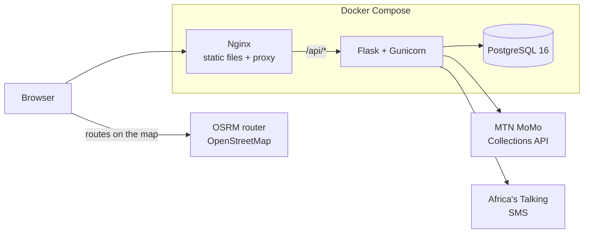
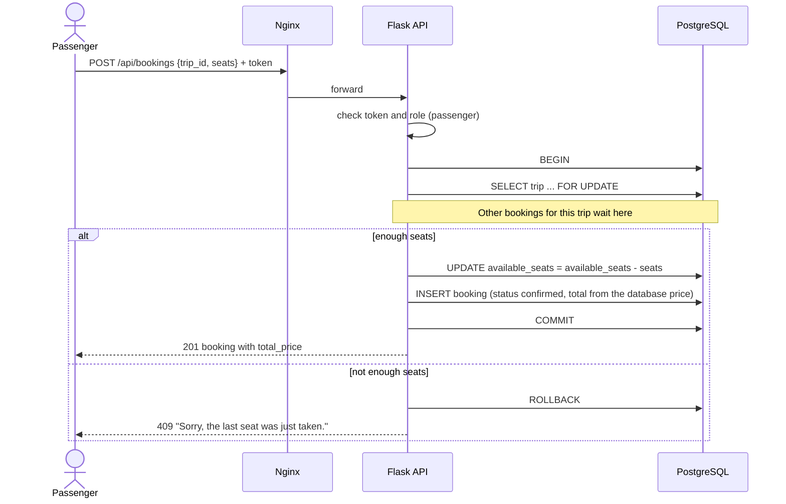
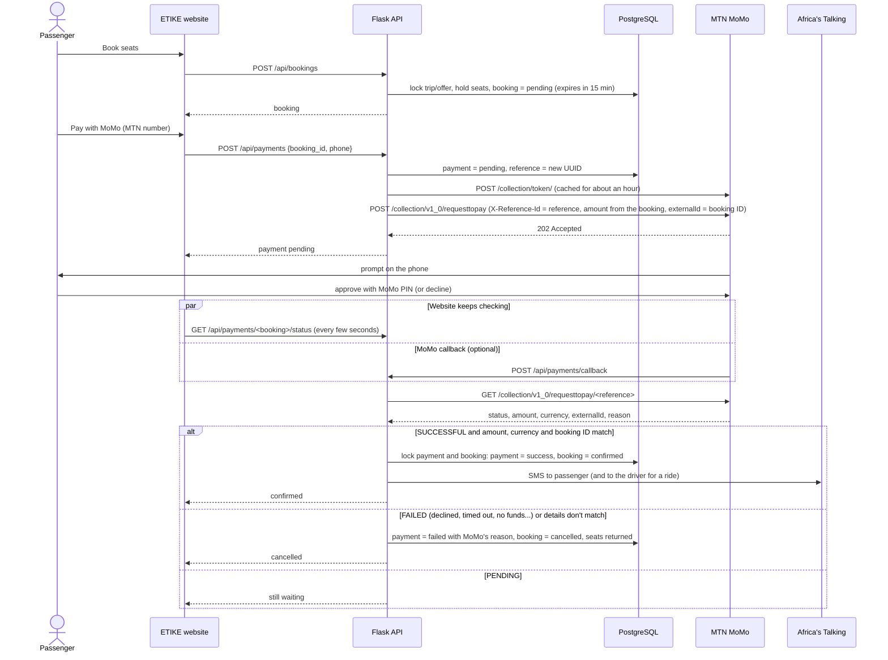

# Architecture

ETIKE is a three-tier client–server application. Everything runs in Docker containers started by Docker Compose.

| Tier | Technology | Job |
|------|------------|-----|
| Frontend | Plain HTML, CSS and JavaScript | What passengers, drivers and staff see in the browser |
| Backend | Python 3.12, Flask REST API, Gunicorn | Business rules and data access, exposed under `/api` |
| Database | PostgreSQL 16 | Stores all data |

Nginx sits in front. It serves the frontend files directly and forwards every `/api/*` request to Flask. The browser only ever talks to Nginx, so there is no cross-origin traffic.

MoMo and Africa's Talking are optional: without their keys, payments answer 503 and SMS is skipped.

## Scope

The platform currently covers **private and shared rides** between districts: drivers post rides, passengers book them and pay the driver directly. **Bus booking is a future phase**: bus companies would need a full operator system (fleets, schedules, ticket scanning), which is a separate product. Its modules below are marked *future phase*. They stay in the code and are tested, but are switched off with `FEATURE_BUS_BOOKING` (default off, `app/features.py`):

- bus endpoints (`/api/trips...`) and admin company endpoints answer 404 "Bus booking is not available yet";
- `POST /api/bookings` answers 400 for a bus booking;
- `GET /api/config` tells the website, which hides every element marked `data-feature="bus"`;
- the data scripts skip bus companies and trips.

No tables or data are removed; the booking service stays generic and still supports bus trips internally.

## Backend modules

| Module | Where | What it does |
|--------|-------|--------------|
| Models | `app/models/` | `users`, `drivers`, `vehicles`, `bus_companies`, `routes`, `bus_trips`, `ride_offers`, `bookings`, `payments`, `ratings`, with CHECK constraints for allowed values, seat counts and scores |
| Auth | `app/auth/` | Log in with an SMS code (no account to create) or a password, driver sign-up, `/me`. JWT tokens (Flask-JWT-Extended), Werkzeug password hashes, login codes stored as keyed hashes, and the `role_required` decorator |
| Search | `app/routes/search.py` | Places, routes, ride offers, and (future phase) bus trips. Public. Also `GET /api/config` |
| Drivers | `app/routes/drivers.py` | Vehicles, and posting rides (approved drivers only) |
| Bookings | `app/routes/bookings.py`, `app/services/booking_service.py` | Book (pending, seats held), confirm, cancel and release expired holds, without double booking |
| Payments *(future phase, behind FEATURE_BUS_BOOKING)* | `app/routes/payments.py`, `app/services/payment_service.py`, `app/services/momo_client.py` | MTN MoMo request to pay: start, check status, callback |
| SMS | `app/services/sms_service.py` | Booking confirmations through Africa's Talking; failures are logged, never raised |
| Ratings | `app/routes/ratings.py` | Passengers rate drivers after a ride; keeps `drivers.avg_rating` up to date |
| Admin | `app/routes/admin.py` | Approve or reject drivers; *future phase:* verify bus companies, refunds for paid tickets (admin role only) |
| Validation and errors | `app/validation.py`, `app/errors.py` | Input checks and one JSON error format |
| Places | `app/places.py` | The 28 places people travel between (Kigali's three districts count as one) and old town names such as Butare for Huye |
| Commands | `app/cli.py` | `flask create-admin`, `flask approve-driver`, `flask expire-bookings`, `flask momo-create-user` (sandbox) |

Data gets in through `data/scripts/clean_data.py` and `load_data.py`, from files the team collected (see [data/README.md](../data/README.md)). Nothing is seeded.

## Booking without double booking

Every booking runs in one database transaction. The bus trip or ride offer row is locked with `SELECT ... FOR UPDATE` before its seats are checked. If two passengers try to take the last seat at the same moment, the second request waits until the first commits, then sees no seats left and gets a 409. A test in `backend/tests/test_bookings.py` runs exactly this case against PostgreSQL.

Rules the service applies:

- The price always comes from the database. Anything the client sends as a price is ignored.
- Shared ride: total is price × seats. Private ride: one price for the whole car, and it books all its seats at once.
- An offer whose seats reach 0 becomes `full`. Cancelling a booking returns its seats and reopens a `full` offer.
- Bookings are `confirmed` straight away until payments arrive in a later sprint.

## Paying for a booking *(future phase, behind FEATURE_BUS_BOOKING)*

Only **bus tickets** are paid on the website. A new bus booking is `pending` and holds its seats for `BOOKING_HOLD_MINUTES` (15 by default). The passenger pays with MTN MoMo and approves on their own phone:

Rules the payment service applies:

- The amount always comes from the booking. Anything the client sends as an amount is ignored.
- Every request to pay gets a new UUID, stored as the payment's unique reference.
- A callback is only a hint. Anyone can call that address, so the API uses it only to find the payment, then asks MoMo for the real status before changing anything.
- Settling is done once, under a row lock: a second callback or status check for the same payment changes nothing.
- An SMS is sent after the database commit, and its failure is only logged, so SMS can never undo a booking.
- If the 15 minutes run out, the booking is cancelled and its seats return (before every search and booking, and by `flask expire-bookings` from cron). If the payment still succeeds afterwards, the seats are taken again if they are free; if not, the booking stays cancelled and an error is logged so the payment can be refunded by hand. Automatic refunds are not built yet.

## Rides, cancelling and refunds

- **Shared and private rides are not paid on the website.** The booking is `confirmed` as soon as the seats are taken (under the same row lock), and the passenger pays the driver during or after the ride. `POST /api/payments` refuses ride bookings.
- **Cancelling.** An unpaid booking can be cancelled at any time. A confirmed booking can be cancelled until `CANCEL_CUTOFF_HOURS` (2 by default) before departure; after that the API answers 409 `too_late_to_cancel`. Cancelling returns the seats and reopens a `full` ride.
- **Refunds.** Cancelling a paid bus ticket sets `payments.refund_status` to `due` (the payment itself stays `success`, because the money was received). Admins list refunds due, send the money to the passenger's MoMo number by hand, and mark each one `refunded`. Automatic refunds would need MoMo's Disbursements product and are not built.
- **SMS.** The passenger, and the driver for a ride, are told about a confirmed booking and about a cancellation.

## Seats, tickets and photos

Seat maps and QR tickets were built for buses and are part of the future phase; car photos are current scope.

- **Seats.** `booking_seats` holds one row per seat per active booking, with `UNIQUE(trip_id, seat_number)` and `UNIQUE(offer_id, seat_number)`. Seats are chosen and checked while the trip or ride row is locked, and the unique constraints are a second guard. Cancelling or expiring deletes the rows (the booking keeps `seat_numbers` as a record). Seat maps are drawn from the seat count (`app/services/seat_service.py`).
- **Tickets.** The QR code (made with `segno`) holds a link to `/verify.html` with a token signed with `SECRET_KEY` (itsdangerous). The check is public and live, and shows only what boarding staff need.
- **Photos.** Uploaded to `UPLOAD_DIR` (the `uploads` volume) under random names, after checking the file's first bytes are a JPEG, PNG or WebP. Nginx serves them at `/uploads/` with `Content-Security-Policy: default-src 'none'`, and allows 4 MB only on the upload address.

## Environments

- **Local**: `docker-compose.yml`. Flask dev server with auto-reload, code mounted from your machine.
- **Staging and production**: `docker-compose.prod.yml` on a VPS. Gunicorn, restart policies, secrets from the server's `.env`. Staging and production are separate servers (or separate folders with separate `.env` files).

## CI/CD

- `ci.yml` runs on every pull request and every push to `main`: ruff, then `flask db upgrade` against a Postgres service container, then pytest on that database.
- `deploy.yml` runs on every push to `main`: it SSHes into the staging server, runs `git pull`, rebuilds with `docker compose -f docker-compose.prod.yml up -d --build`, then applies migrations with `flask db upgrade`. Without the secrets below it skips itself.
- Required GitHub secrets: `STAGING_HOST`, `STAGING_USER`, `STAGING_SSH_KEY`.

## Servers, HTTPS and backups

Step-by-step server setup, HTTPS with Let's Encrypt, nightly backups and restores, creating the first admin, and the security checklist are in [deployment.md](deployment.md).

## Where future code goes

Each new module gets a blueprint in `backend/app/routes/`, models in `backend/app/models/`, business rules in `backend/app/services/` when they are more than a few lines, and its own tests in `backend/tests/`. Not built yet:

| Module | Purpose |
|--------|---------|
| bus phase | Bus booking with an operator portal (fleets, schedules), ticket scanning at boarding and operator payouts; switch on `FEATURE_BUS_BOOKING` |
| automatic refunds | Sending refunds through MoMo Disbursements instead of by hand |
| pickup details | A pickup point on each ride, and sharing phone numbers between driver and passenger |
| bus company staff | Companies managing their own trips |
