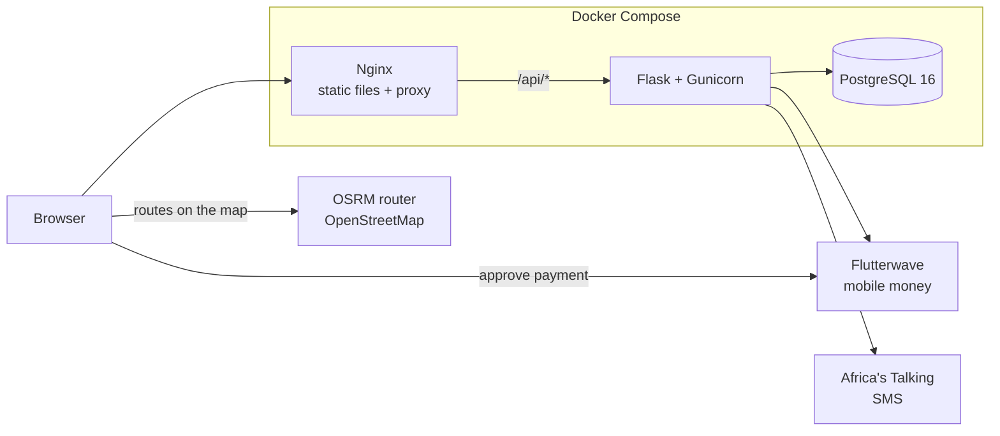
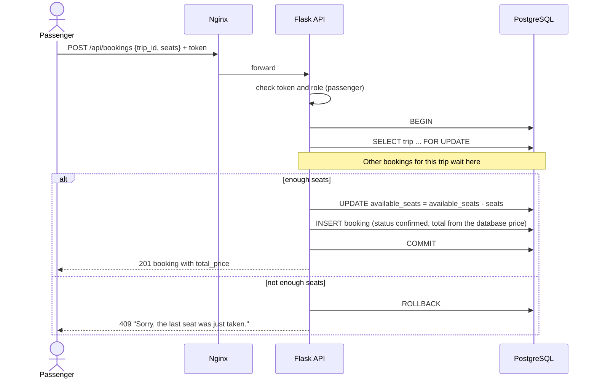
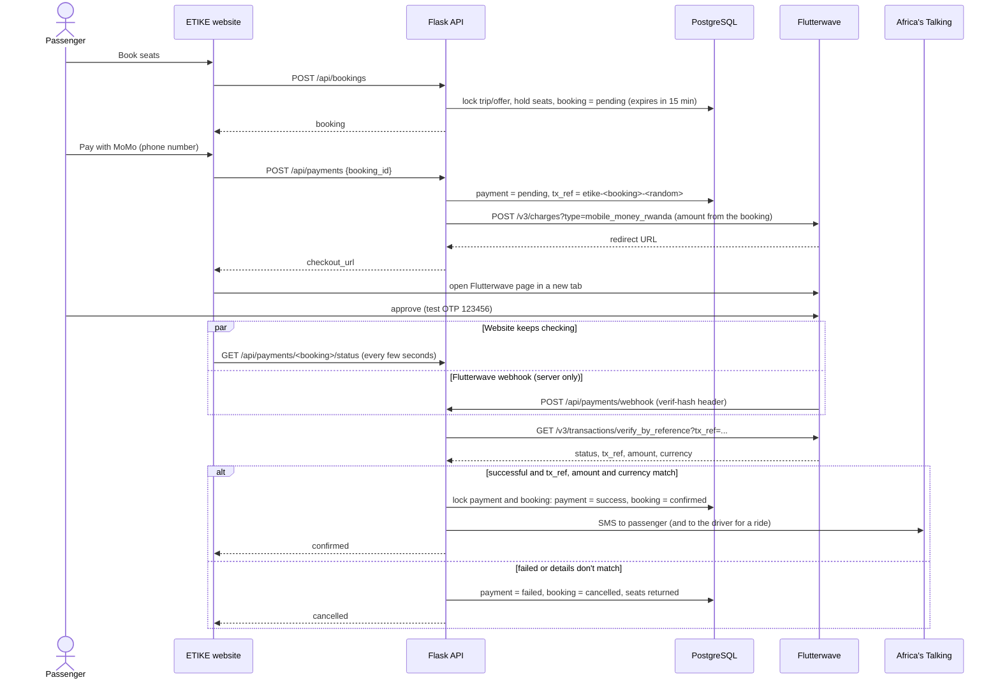

# Architecture

ETIKE is a three-tier client–server application. Everything runs in Docker containers started by Docker Compose.

| Tier | Technology | Job |
|------|------------|-----|
| Frontend | Plain HTML, CSS and JavaScript | What passengers, drivers and staff see in the browser |
| Backend | Python 3.12, Flask REST API, Gunicorn | Business rules and data access, exposed under `/api` |
| Database | PostgreSQL 16 | Stores all data |

Nginx sits in front. It serves the frontend files directly and forwards every `/api/*` request to Flask. The browser only ever talks to Nginx, so there is no cross-origin traffic.

Flutterwave and Africa's Talking are optional: without their keys, payments answer 503 and SMS is skipped.

## Backend modules

| Module | Where | What it does |
|--------|-------|--------------|
| Models | `app/models/` | `users`, `drivers`, `vehicles`, `bus_companies`, `routes`, `bus_trips`, `ride_offers`, `bookings`, `payments`, `ratings`, with CHECK constraints for allowed values, seat counts and scores |
| Auth | `app/auth/` | Register, log in, `/me`. JWT tokens (Flask-JWT-Extended), Werkzeug password hashes, and the `role_required` decorator |
| Search | `app/routes/search.py` | Places, routes, bus trips and ride offers. Public |
| Drivers | `app/routes/drivers.py` | Vehicles, and posting rides (approved drivers only) |
| Bookings | `app/routes/bookings.py`, `app/services/booking_service.py` | Book (pending, seats held), confirm, cancel and release expired holds, without double booking |
| Payments | `app/routes/payments.py`, `app/services/payment_service.py`, `app/services/flutterwave_client.py` | Rwanda mobile money through Flutterwave: start, verify, webhook |
| SMS | `app/services/sms_service.py` | Booking confirmations through Africa's Talking; failures are logged, never raised |
| Ratings | `app/routes/ratings.py` | Passengers rate drivers after a ride; keeps `drivers.avg_rating` up to date |
| Admin | `app/routes/admin.py` | Approve or reject drivers, verify bus companies (admin role only) |
| Validation and errors | `app/validation.py`, `app/errors.py` | Input checks and one JSON error format |
| Places | `app/places.py` | The 28 places people travel between (Kigali's three districts count as one) and old town names such as Butare for Huye |
| Commands | `app/cli.py` | `flask create-admin`, `flask approve-driver`, `flask expire-bookings` |

Data gets in through `data/scripts/clean_data.py` and `load_data.py`, from files the team collected (see [data/README.md](../data/README.md)). Nothing is seeded.

## Booking without double booking

Every booking runs in one database transaction. The bus trip or ride offer row is locked with `SELECT ... FOR UPDATE` before its seats are checked. If two passengers try to take the last seat at the same moment, the second request waits until the first commits, then sees no seats left and gets a 409. A test in `backend/tests/test_bookings.py` runs exactly this case against PostgreSQL.

Rules the service applies:

- The price always comes from the database. Anything the client sends as a price is ignored.
- Shared ride: total is price × seats. Private ride: one price for the whole car, and it books all its seats at once.
- An offer whose seats reach 0 becomes `full`. Cancelling a booking returns its seats and reopens a `full` offer.
- Bookings are `confirmed` straight away until payments arrive in a later sprint.

## Paying for a booking

A new booking is `pending` and holds its seats for `BOOKING_HOLD_MINUTES` (15 by default). The passenger pays with Rwanda mobile money through Flutterwave:

Rules the payment service applies:

- The amount always comes from the booking. Anything the client sends as an amount is ignored.
- A webhook is only a hint. Its secret hash must match `FLW_SECRET_HASH`, and even then the API asks Flutterwave for the transaction before changing anything.
- Settling is done once, under a row lock: a second webhook or status check for the same payment changes nothing.
- An SMS is sent after the database commit, and its failure is only logged, so SMS can never undo a booking.
- If the 15 minutes run out, the booking is cancelled and its seats return (before every search and booking, and by `flask expire-bookings` from cron). If the payment still succeeds afterwards, the seats are taken again if they are free; if not, the booking stays cancelled and an error is logged so the payment can be refunded by hand. Automatic refunds are not built yet.

## Environments

- **Local**: `docker-compose.yml`. Flask dev server with auto-reload, code mounted from your machine.
- **Staging and production**: `docker-compose.prod.yml` on a VPS. Gunicorn, restart policies, secrets from the server's `.env`. Staging and production are separate servers (or separate folders with separate `.env` files).

## CI/CD

- `ci.yml` runs on every pull request and every push to `main`: ruff, then `flask db upgrade` against a Postgres service container, then pytest on that database.
- `deploy.yml` runs on every push to `main`: it SSHes into the staging server, runs `git pull`, rebuilds with `docker compose -f docker-compose.prod.yml up -d --build`, then applies migrations with `flask db upgrade`. Without the secrets below it skips itself.
- Required GitHub secrets: `STAGING_HOST`, `STAGING_USER`, `STAGING_SSH_KEY`.

## Servers, HTTPS and backups

Step-by-step server setup, HTTPS with Let's Encrypt, nightly backups and restores, creating the first admin, and the security checklist are in [deployment.md](deployment.md).

## Where future code goes

Each new module gets a blueprint in `backend/app/routes/`, models in `backend/app/models/`, business rules in `backend/app/services/` when they are more than a few lines, and its own tests in `backend/tests/`. Not built yet:

| Module | Purpose |
|--------|---------|
| refunds | Refunding paid bookings that are cancelled or paid too late |
| bus company staff | Companies managing their own trips |
