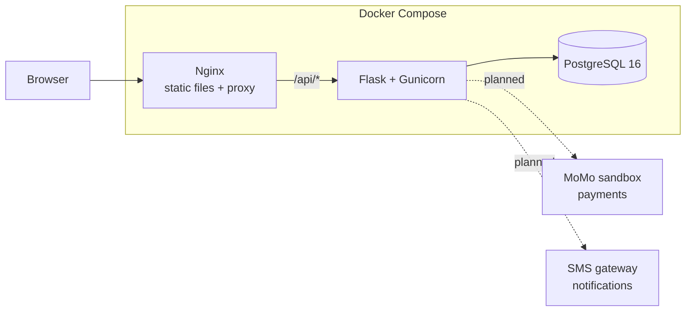
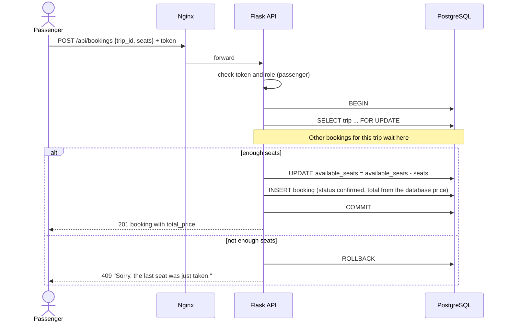

# Architecture

ETIKE is a three-tier client–server application. Everything runs in Docker containers started by Docker Compose.

| Tier | Technology | Job |
|------|------------|-----|
| Frontend | Plain HTML, CSS and JavaScript | What passengers, drivers and staff see in the browser |
| Backend | Python 3.12, Flask REST API, Gunicorn | Business rules and data access, exposed under `/api` |
| Database | PostgreSQL 16 | Stores all data |

Nginx sits in front. It serves the frontend files directly and forwards every `/api/*` request to Flask. The browser only ever talks to Nginx, so there is no cross-origin traffic.

Solid lines exist now. Dotted lines are planned for later sprints.

## Backend modules

| Module | Where | What it does |
|--------|-------|--------------|
| Models | `app/models/` | `users`, `drivers`, `vehicles`, `bus_companies`, `routes`, `bus_trips`, `ride_offers`, `bookings`, with CHECK constraints for allowed values and seat counts |
| Auth | `app/auth/` | Register, log in, `/me`. JWT tokens (Flask-JWT-Extended), Werkzeug password hashes, and the `role_required` decorator |
| Search | `app/routes/search.py` | Places, routes, bus trips and ride offers. Public |
| Drivers | `app/routes/drivers.py` | Vehicles, and posting rides (approved drivers only) |
| Bookings | `app/routes/bookings.py`, `app/services/booking_service.py` | Book and cancel without double booking |
| Validation and errors | `app/validation.py`, `app/errors.py` | Input checks and one JSON error format |
| Places | `app/places.py` | The 28 places people travel between (Kigali's three districts count as one) and old town names such as Butare for Huye |
| Admin command | `app/cli.py` | `flask approve-driver` until there is an admin dashboard |

Data gets in through `data/scripts/clean_data.py` and `load_data.py`, from files the team collected (see [data/README.md](../data/README.md)). Nothing is seeded.

## Booking without double booking

Every booking runs in one database transaction. The bus trip or ride offer row is locked with `SELECT ... FOR UPDATE` before its seats are checked. If two passengers try to take the last seat at the same moment, the second request waits until the first commits, then sees no seats left and gets a 409. A test in `backend/tests/test_bookings.py` runs exactly this case against PostgreSQL.

Rules the service applies:

- The price always comes from the database. Anything the client sends as a price is ignored.
- Shared ride: total is price × seats. Private ride: one price for the whole car, and it books all its seats at once.
- An offer whose seats reach 0 becomes `full`. Cancelling a booking returns its seats and reopens a `full` offer.
- Bookings are `confirmed` straight away until payments arrive in a later sprint.

## Environments

- **Local**: `docker-compose.yml`. Flask dev server with auto-reload, code mounted from your machine.
- **Staging and production**: `docker-compose.prod.yml` on a VPS. Gunicorn, restart policies, secrets from the server's `.env`. Staging and production are separate servers (or separate folders with separate `.env` files).

## CI/CD

- `ci.yml` runs on every pull request and every push to `main`: ruff, then `flask db upgrade` against a Postgres service container, then pytest on that database.
- `deploy.yml` runs on every push to `main`: it SSHes into the staging server, runs `git pull`, then `docker compose -f docker-compose.prod.yml up -d --build`.
- Required GitHub secrets: `STAGING_HOST`, `STAGING_USER`, `STAGING_SSH_KEY`.

## Preparing the VPS

1. Install Docker Engine and the Compose plugin (https://docs.docker.com/engine/install/ubuntu/).
2. Create a deploy user, add it to the `docker` group, and add the public half of a new SSH key pair to `~/.ssh/authorized_keys`. Put the private half in the `STAGING_SSH_KEY` secret.
3. Clone the repository to `~/etike` (the deploy workflow expects this path). Use a read-only deploy key if the repo is private.
4. In `~/etike`, run `cp .env.example .env`, set `FLASK_ENV=production`, and replace every `change-me` with a strong value. Make `DATABASE_URL` match the Postgres user, password and database.
5. Run `docker compose -f docker-compose.prod.yml up -d --build` once by hand, then `docker compose -f docker-compose.prod.yml exec api flask --app wsgi db upgrade`, and check `curl http://localhost/api/health`. Run the `upgrade` again after each deploy that adds a migration.
6. Open ports 22, 80 and 443 in the firewall; close everything else.

## HTTPS with Let's Encrypt

Certificates are issued on the server with Certbot, outside Docker, and Nginx reads them from `/etc/letsencrypt`.

1. Point your domain's DNS A record at the server.
2. `sudo apt install certbot` and `sudo mkdir -p /var/www/certbot`.
3. With the stack running on port 80, get a certificate:
   `sudo certbot certonly --webroot -w /var/www/certbot -d YOUR_DOMAIN`
4. Copy `nginx/https.conf.example` to `nginx/https.conf`, replace `YOUR_DOMAIN`, and in `docker-compose.prod.yml` change the mounted file from `./nginx/default.conf` to `./nginx/https.conf`.
5. Restart: `docker compose -f docker-compose.prod.yml up -d`.
6. Certbot renews automatically; reload Nginx after renewal by adding `--deploy-hook "docker compose -f /home/DEPLOY_USER/etike/docker-compose.prod.yml exec nginx nginx -s reload"` to the renewal config, or run that command monthly.

## Where future code goes

Each new module gets a blueprint in `backend/app/routes/`, models in `backend/app/models/`, business rules in `backend/app/services/` when they are more than a few lines, and its own tests in `backend/tests/`. Not built yet:

| Module | Purpose |
|--------|---------|
| payments | MoMo sandbox integration |
| ratings | Passenger and driver feedback |
| notifications | SMS and in-app messages |
| admin | Approving drivers and verifying bus companies in the browser |
| bus company staff | Companies managing their own trips |
